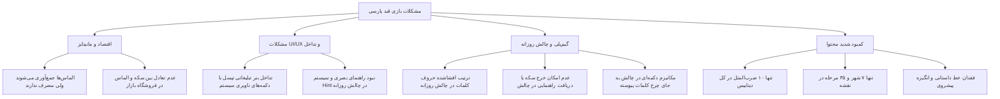
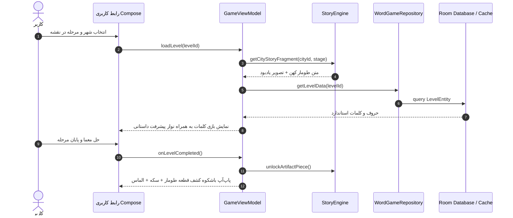

# 📋 سند جامع عیب‌یابی، بررسی تخصصی و برنامه آپدیت بزرگ بازی «قند پارسی»

---

## ۱. خلاصه‌ی بازبینی فنی و فهرست بحرانی مشکلات (Audit Findings)

پس از واکاوی عمیق کدهای سورس پروژه در لایه‌های `Presentation`، `Domain`، `Data` و `Ad/Monetization`، مشکلات به دو دسته‌ی **«باگ‌ها و ایرادات ساختاری فعلی»** و **«کمبودهای محتوایی و طراحی بازی (Game Design)»** تفکیک شدند:



---

## ۲. کالبدشکافی موشکافانه مشکلات گزارش‌شده

### ۲.۱. بحران اقتصادی: الماس‌ها هیچ جا مصرف نمی‌شوند!
* **محل رخداد در کد:** فایل `GameViewModel.kt` (خطوط ۱۱۵۷-۱۱۶۰) و `GameConfig.kt`
* **شرح مشکل:** تابع `addGems(amount)` در سراسر کدهای بازی صدا زده می‌شود (پایان مرحله، گردونه شانس، تماشای تبلیغ جایزه‌ای، بسته‌های بازار)، اما **هیچ متدی به نام `spendGems` یا هیچ ویژگی قابل خریدی با الماس در کل بازی پیاده‌سازی نشده است!**
* **پیامد:** کاربر احساس فریب‌خوردگی می‌کند؛ خرید بسته‌های الماس‌دار در کافه بازار برای کاربر بی‌فایده بوده و موجب نظرات ۱ ستاره و افت رتبه در کافه بازار می‌شود.

### ۲.۲. مشکل نمایش بنر تبلیغاتی استاندارد (هم‌پوشانی با دکمه‌های گوشی)
* **محل رخداد در کد:** `MainActivity.kt` (خط ۶۷ و خطوط ۲۱۲-۲۲۷) و `TapsellBannerAd.kt`
* **ریشه باگ:** در `onCreate` تابع `enableEdgeToEdge()` فعال شده است که صفحه را تمام‌صفحه (Edge-to-Edge) می‌کند. اما برای کامپوننت `TapsellBannerAd` درون `bottomBar` از `Modifier.navigationBarsPadding()` یا `WindowInsets.navigationBars` استفاده نشده است.
* **پیامد:** بنر تبلیغاتی تپسل دقیقاً پشت ۳ کلید مجازی اندروید (Back, Home, Recents) یا خط Gesture Bar مخفی شده و کلیک نمی‌خورد، نمایش آن ناقص است و طبق قوانین تپسل ممکن است تخلف نقض دید تبلیغ (Ad Invalidation) ثبت شود.

### ۲.۳. مشکلات اساسی چالش روزانه (Daily Challenge)
* **محل رخداد در کد:** `GameRepository.kt` (خطوط ۵۸۴-۶۰۵)، `DailyChallengeScreen.kt` و `GameViewModel.kt` (خطوط ۸۵۰-۹۳۰)
1. **لو رفتن پاسخ‌ها به صورت مرتب:** در آرایه `dailyChallenges`، لیست حروف `letters` با املای دقیق کلمات اول و دوم پر شده است! به عنوان مثال:
   * چالش اول: کلمه اول «سفیر» است -> حروف: `['س', 'ف', 'ی', 'ر', 'ا', 'ن']` (۴ حرف اول عیناً کلمه هدف است).
   * چالش سوم: کلمات «موج» و «دریا» -> حروف: `['م', 'و', 'ج', 'د', 'ر', 'ی', 'ا']` (دقیقاً پشت سر هم!).
2. **غیرقابل فهم بودن و نبود راهنمایی:** صفحه چالش هیچ ابزار راهنمایی (Hint) ندارد؛ دکمه‌ای برای آشکار کردن یک حرف در ازای سکه وجود ندارد و کاربر اگر گیر کند راهی جز بستن بازی ندارد.
3. **نبود امکان خرج سکه:** هیچ امکانی برای تعویض تصادفی حروف، خرید یک راهنمایی حرفی با سکه، یا باز کردن مرحله با سکه در چالش روزانه وجود ندارد.

### ۲.۴. فقر شدید محتوا
* **ضرب‌المثل‌ها:** در `GameRepository.kt` فقط ۱۰ ضرب‌المثل کدنویسی شده است. کاربر بعد از ۱۵ دقیقه بازی بخش ضرب‌المثل‌ها را به اتمام می‌رساند!
* **شهرها و مراحل:** تنها ۷ شهر (اصفهان، تهران، شیراز، کیش، گیلان، مشهد، یزد) با ۵ مرحله برای هر کدام (مجموعاً ۳۵ مرحله) وجود دارد. این مقدار برای یک بازی مدرن کلمات حتی برای انتشار نسخه آلفا هم بسیار کم است.

---

## ۳. طرح تفصیلی و معماری آپدیت بزرگ (The Grand Update)



---

## ۴. اقدامات اجرایی و راه‌حل‌های کُد برای هر بخش

### ۱) اصلاح و فعال‌سازی مصرف الماس‌ها (Diamond Economy)
الماس را به «ارز پرمیوم» واقعی بازی تبدیل می‌کنیم:
1. **صرافی قند پارسی (تبدیل الماس به سکه):**
   * ۵ الماس = ۲۰۰ سکه
   * ۱۰ الماس = ۵۰۰ سکه
   * ۲۵ الماس = ۱۵۰۰ سکه
2. **راهنمای جادویی (Magic Feather / شاه‌کلید):**
   * در ازای ۲ الماس، یکی از سخت‌ترین کلمات جدول بلافاصله آشکار شود.
3. **جعبه اسرار شهر (Secret Chest):**
   * باز کردن فوری صندوقچه هر شهر با ۳ الماس برای دریافت سوغات داستانی، آواتارهای ویژه و تم تخته کلمات.
4. **تکرار چرخش گردونه شانس:**
   * پس از چرخش روزانه، چرخش مجدد به جای تبلیغ با ۲ الماس ممکن باشد.

### ۲) اصلاح نحوه استقرار بنر استاندارد تپسل
در `MainActivity.kt`:
```kotlin
bottomBar = {
    val gameplayRoutes = setOf(
        ScreenRoute.WORD_GAME,
        ScreenRoute.PROVERB_GAME,
        ScreenRoute.DAILY_CHALLENGE,
        ScreenRoute.FORTUNE_WHEEL
    )
    if (!isAdsRemoved && route !in gameplayRoutes) {
        Box(
            modifier = Modifier
                .fillMaxWidth()
                .navigationBarsPadding() // جلوگیری از هم‌پوشانی با کلیدهای گوشی
                .background(MaterialTheme.colorScheme.surface)
        ) {
            TapsellBannerAd(
                modifier = Modifier
                    .fillMaxWidth()
                    .padding(vertical = 4.dp)
            )
        }
    }
}
```

### ۳) بازطراحی چالش روزانه (Daily Challenge Revamp)
1. **شافل خودکار حروف:**
   * تمام حروف چالش در هنگام لود از طریق `letters.shuffled(Random(seed))` به‌طور تضمینی به‌هم ریخته شوند تا جواب اول و دوم لو نرود.
2. **افزودن امکانات سکه‌ای:**
   * دکمه **«راهنمایی روزانه»** با هزینه ۴۰ سکه: یک حرف تصادفی در خانه‌های خالی کلمات آشکار می‌شود.
   * دکمه **«تکان دادن حروف (Shuffle)»** رایگان با انیمیشن زیبا.
3. **بهبود بصری و شفاف‌سازی هدف:**
   * اضافه کردن نوار درصد پیشرفت روزانه و راهنمای کوتاه در اولین ورود (Tooltip).

### ۴) ۵۰۰ ضرب‌المثل جذاب به همراه معنا و ایموجی
* انتقال دیتای ضرب‌المثل‌ها به فایل دیتابیس محلی یا JSON استاندارد با بیش از **۵۰۰ ضرب‌المثل اصیل پارسی** با فیلدهای:
  * متن پوشانده شده (`maskedProverb`)
  * کلمه جاافتاده (`missingWord`)
  * ریشه و مفهوم عامیانه (`meaning`)
  * کلید تصویری ایموجی (`emojiClue`)
  * حروف به هم ریخته استاندارد (`scrambledLetters`)

### ۵) توسعه نقشه به ۱۵۰ شهر ایران با ۳,۰۰۰ الی ۴,۵۰۰ ماجراجویی داستانی
* شهرهای ایران از ۳۱ استان (از تبریز و ارومیه و رشت و گرگان تا چابهار، بوشهر، اهواز، سنندج، کرمانشاه، یزد، نیشابور، قزوین، کاشان و ...).
* هر شهر شامل **۲۰ الی ۳۰ مرحله جذاب** با افزایش تدریجی طول کلمات (از ۳ حرفی ساده تا ۶ حرفی چالشی).

### ۶) خط داستانی اختصاصی: «راز طومار هفت اقلیم»
* **روایت:** «هاتف»، خطاط و جهانگرد جوان، مأموریت یافته تا نسخه‌ی گمشده‌ی دیوان قند پارسی را بازسازی کند. اوراق این دیوان در ۱۵۰ شهر و آبادی ایران‌زمین پراکنده شده‌اند.
* **مکانیزم در بازی:**
  * در هر شهر، هر ۵ مرحله یک «برگ از دفتر خاطرات هاتف» و یک «سوغات کهن» آزاد می‌شود.
  * با تکمیل هر شهر، یک لوح طلایی یادبود آن شهر در تالار افتخارات کاربر نصب می‌شود و جوایز ارزنده‌ای از سکه و الماس به کاربر اعطا می‌گردد.
